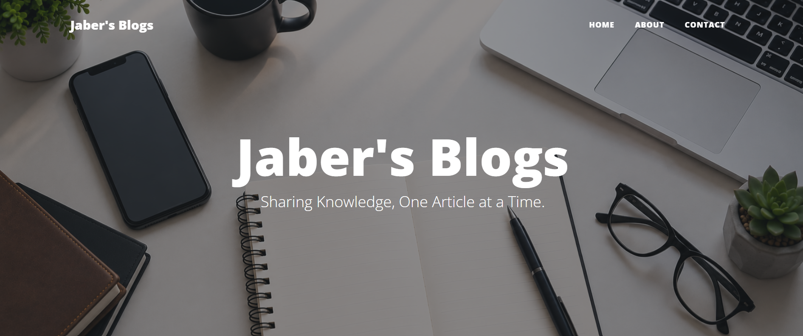
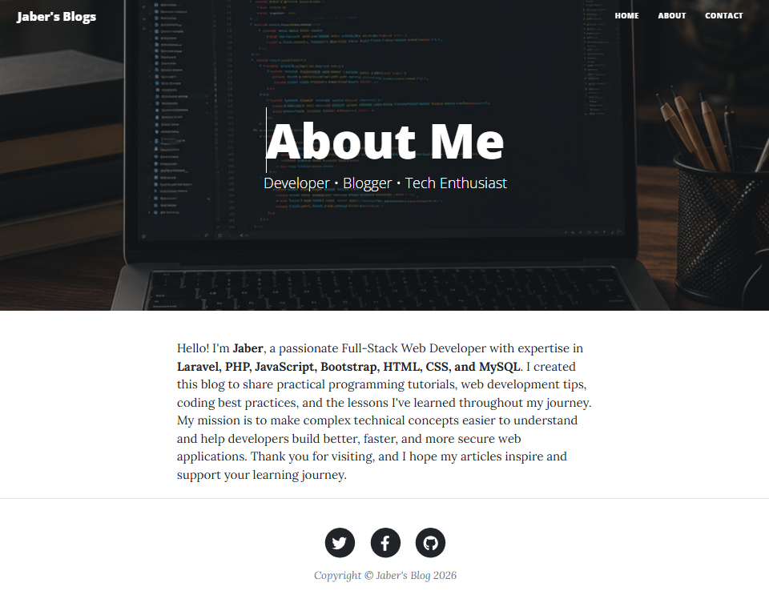
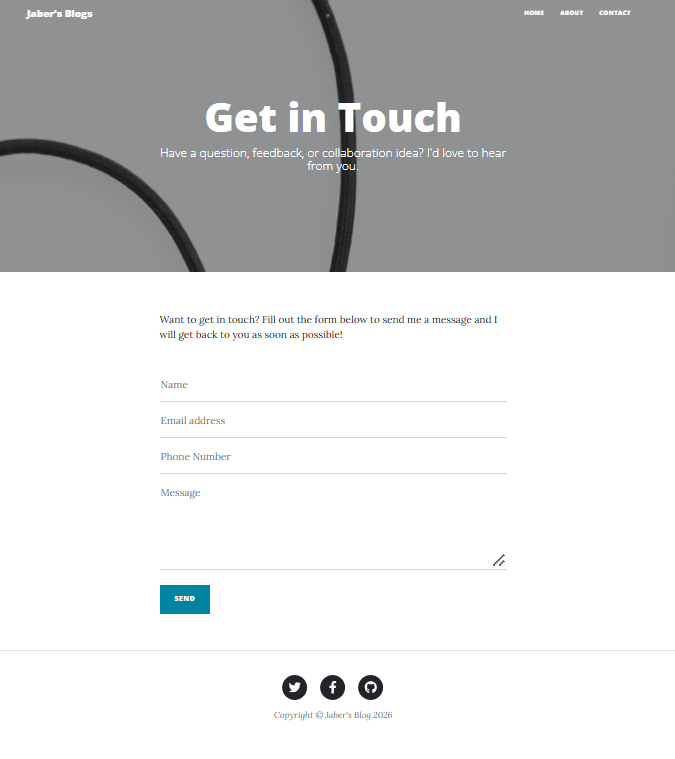
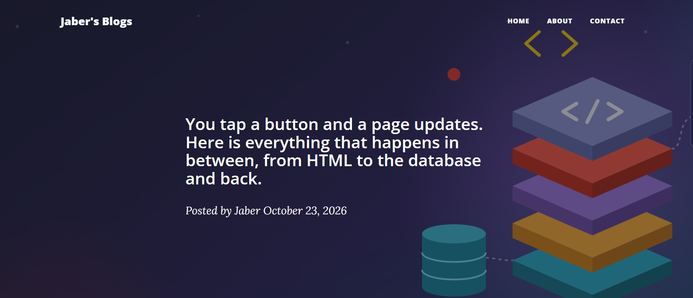
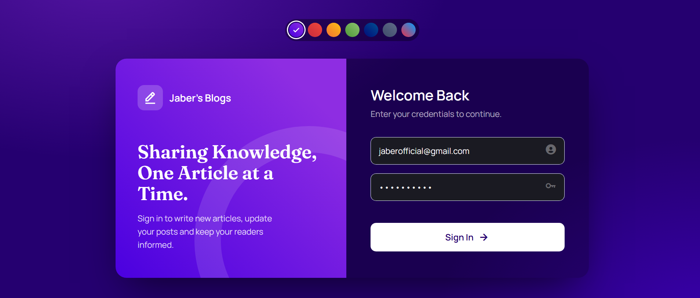
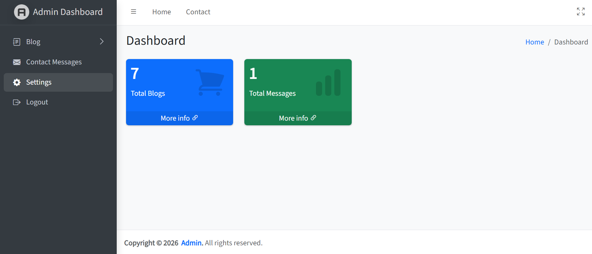
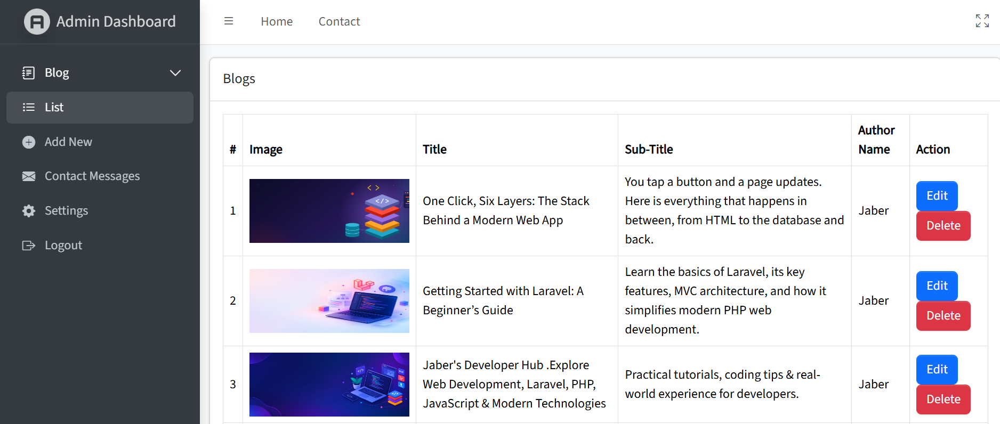
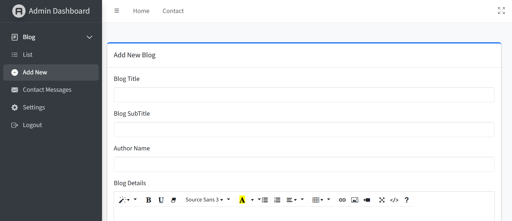
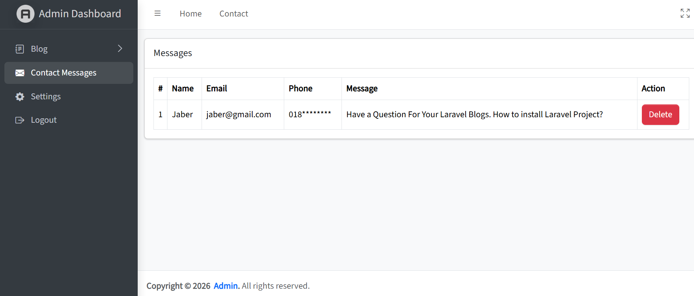
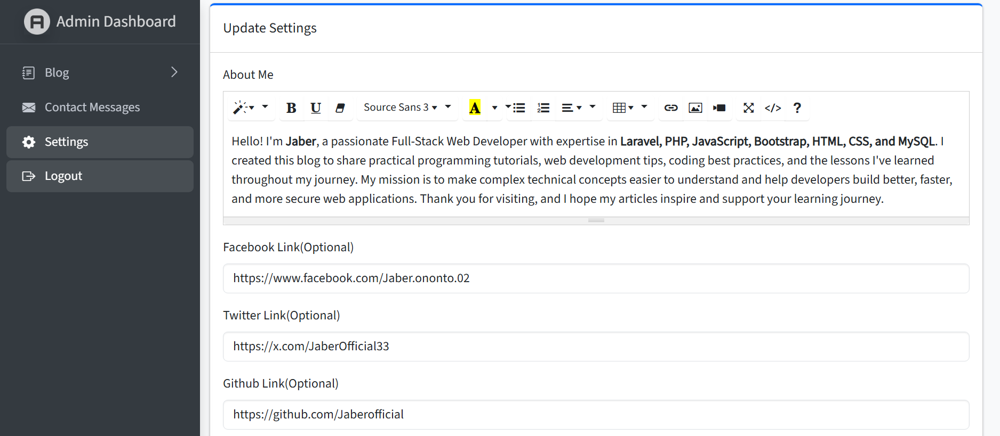

# Jaber's Blogs: Laravel Blog Platform

A full-featured blog website built with **Laravel 10**. It has a public front end for readers and a secure admin panel where the owner writes and manages articles, reads visitor messages, and updates the About page and social links, all without touching code.

> 🎥 Demo video: https://drive.google.com/file/d/1Yf2fxGP9_OrDj_f2GaxA5QZmMDiEFl-n/view?usp=sharing

---

## ✨ Features

### Public website
- Home page with the latest articles (title, subtitle, author, date)
- Pagination for easy browsing through articles
- Blog details page for each article
- About page, with content managed from the admin panel
- Contact form: visitors can send a message (name, email, phone, message)
- Social links (Facebook, Twitter, GitHub) shown from admin settings
- Responsive design

### Admin panel
- Secure login (public registration is disabled)
- Dashboard with total blogs and total messages
- Blog management (full CRUD): add, list, edit and delete posts
- Rich text editor (Summernote) for writing blog content
- Cover image upload for each post
- Contact messages inbox with delete option
- **Settings:** update the About Me content and the Facebook, Twitter and GitHub links
- Toast notifications for every action (success and error)
- Form validation

---

## 🛠 Tech Stack

| Layer | Technology |
|-------|------------|
| Backend | PHP 8.1+, Laravel 10 |
| Database | MySQL |
| Templating | Blade |
| Front end | Bootstrap 5, Vite, Sass |
| Admin UI | AdminLTE-style dashboard |
| Editor | Summernote |
| Notifications | Toastr (`yoeunes/toastr`) |
| Auth | Laravel UI (login only) |

---

## 🗺 Main Routes

| Area | URL | Purpose |
|------|-----|---------|
| Public | `/` | Home / blog list |
| Public | `/blog-details/{id}` | Single article |
| Public | `/about-me` | About page |
| Public | `/contact-me` | Contact form |
| Admin | `/login` | Admin login |
| Admin | `/admin/dashboard` | Dashboard |
| Admin | `/admin/list-blog` | All blogs |
| Admin | `/admin/create-blog` | Add new blog |
| Admin | `/admin/contact-messages` | Visitor messages |
| Admin | `/admin/settings` | About & social links |

---

## 🚀 Getting Started

### Requirements
- PHP 8.1 or higher
- Composer
- Node.js and npm
- MySQL (XAMPP, Laragon or similar)

### Installation

```bash
# 1. Clone the repository
git clone https://github.com/Jaberofficial/laravel-blog-project.git
cd laravel-blog-project

# 2. Install dependencies
composer install
npm install

# 3. Create the environment file
cp .env.example .env
php artisan key:generate
```

### Database setup

Create an empty MySQL database, then update the database settings in your `.env` file with your own details:

```env
DB_CONNECTION=mysql
DB_HOST=127.0.0.1
DB_PORT=3306
DB_DATABASE=your_database_name
DB_USERNAME=your_database_user
DB_PASSWORD=your_database_password
```

Run the migrations:

```bash
php artisan migrate
```

### Create the admin user

Registration is disabled, so create the admin account with Tinker:

```bash
php artisan tinker
```

```php
\App\Models\User::create([
    'name'     => 'Your Name',
    'email'    => 'your-email@example.com',
    'password' => bcrypt('choose-a-strong-password'),
]);
```

Then add the first settings row (this enables the About page and social links):

```php
\App\Models\Setting::create(['about_me' => 'Write something about yourself...']);
```

> If `Setting` has guarded fields, you can instead run `php artisan db:seed --class=SettingSeeder`.

### Run the project

```bash
# Terminal 1
npm run dev

# Terminal 2
php artisan serve
```

Open **http://127.0.0.1:8000** for the site and **http://127.0.0.1:8000/login** for the admin panel.

---

## 📁 Project Structure

```
app/
 ├── Http/Controllers/
 │    ├── Admin/        # AdminController, BlogController
 │    └── Frontend/     # HomePageController
 └── Models/            # Blog, ContactMessage, Setting, User
database/migrations/    # blogs, settings, contact_messages, users
resources/views/
 ├── admin/             # dashboard, blog CRUD, settings, messages
 ├── frontend/          # home, about, contact, blog details
 └── auth/              # login
routes/web.php
public/blogs/           # uploaded blog images
```

---

## 📸 Screenshots

### Public Website

**Home Page**



**About Page**



**Contact Page**



**Blog Details**



### Admin Panel

**Admin Login**



**Dashboard**



**Blog List**



**Add Blog**



**Contact Messages**



**Settings**



---

## 🔮 Planned Improvements
- Deploy to a live server
- Categories and tags
- Search
- Comments

---

## 👤 Author

**Jaber**
- GitHub: [@Jaberofficial](https://github.com/Jaberofficial)

If you like this project, a ⭐ on the repo is much appreciated!

## 📄 License

This project is open-sourced under the [MIT license](https://opensource.org/licenses/MIT).